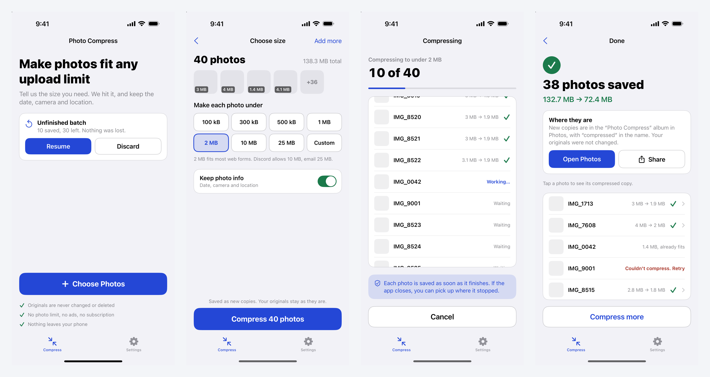
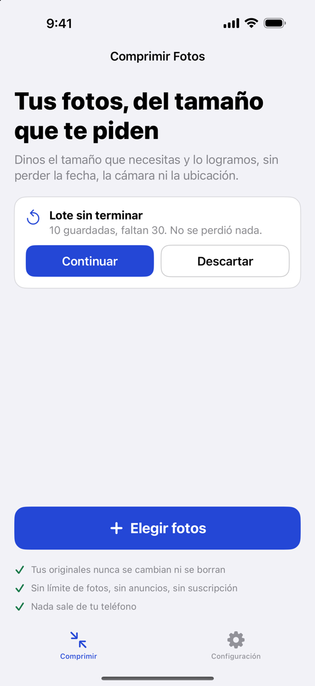
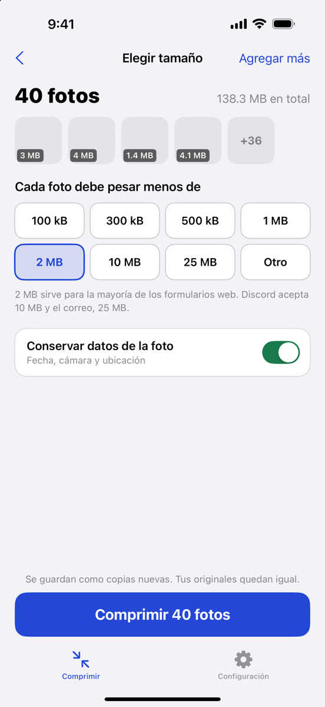
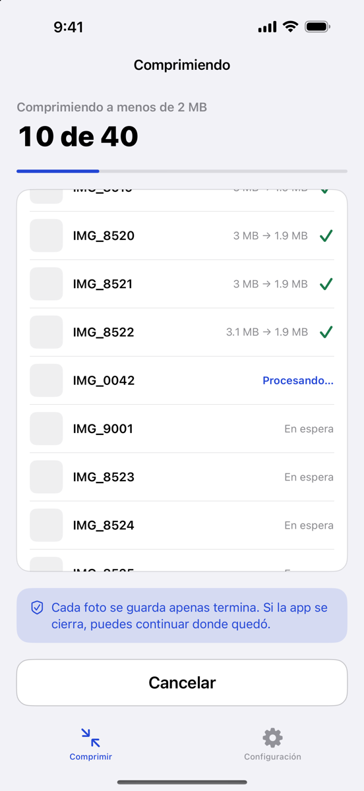
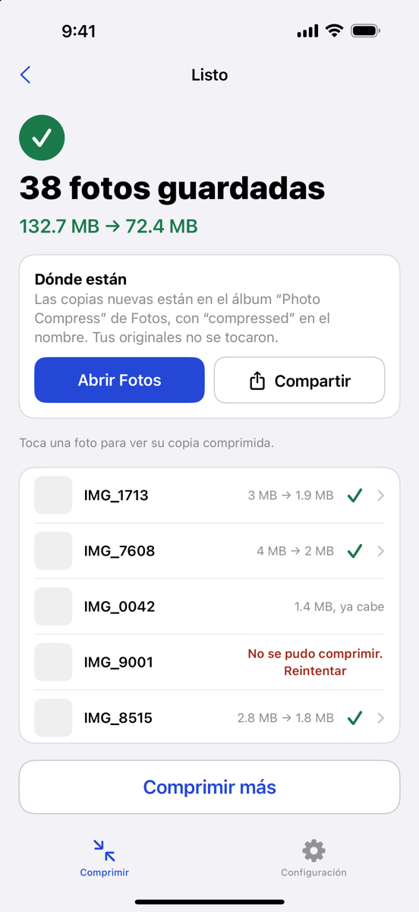

# Photo Compress

**Shrink any photo to an exact file size, on iPhone, without losing its metadata.**




A web form rejects anything over 2 MB. Discord caps uploads at 10 MB. A visa portal wants a
photo under 300 KB. Photo Compress lets you type the limit and finds the highest-quality
version that fits, for as many photos as you pick at once.

## Why it exists

The design came from mining App Store reviews of the top competing apps. Each feature answers
a recurring complaint:

| Reviewers of other apps said | Photo Compress |
|---|---|
| "Only in 5% increments… doesn't give you the size you want" | You enter the target size; the app hits it |
| "Deleting my EXIF data… a show-stopper" (used for insurance claims) | Date, camera and location are kept by default |
| "Only 3 photos at a time without the pro version" | No batch limit |
| "Sits at 0%", "crashes over 50 photos" | Progress is journaled per photo and resumes after a crash |
| "Where do the photos go?" | Copies go to a "Photo Compress" album, named `-compressed` |
| Weekly subscriptions and ads | No ads, no subscription, no network access at all |

## Engineering highlights

- **Size-targeted compression.** Output bytes aren't linear in JPEG quality, so the engine
  binary-searches quality in memory, measuring each encode, and stops within 3% under the
  target. If the lowest acceptable quality is still too big, it downscales 10% with Core Image
  and searches again. ImageIO's size curve is a staircase, so the search runs in whole-percent
  steps to avoid wasted encodes.
  [`CompressionEngine.swift`](PhotoCompress/Core/CompressionEngine.swift)
- **Metadata preserved end to end.** Images are read and written with ImageIO
  (`CGImageSource` → `CGImageDestination`), never `UIImage`, which drops EXIF. A small policy
  type decides whether GPS and camera data are passed through or stripped.
  [`MetadataPolicy.swift`](PhotoCompress/Core/MetadataPolicy.swift)
- **Crash-safe batches.** A Codable journal is written atomically after every photo. Each
  photo is saved to the library before the journal records it, so an interruption can repeat
  at most one photo and never lose one. On relaunch the app offers to resume.
  [`BatchJournal.swift`](PhotoCompress/Core/BatchJournal.swift),
  [`BatchModel.swift`](PhotoCompress/Features/BatchModel.swift)
- **Memory-safe at any batch size.** One decoded image at a time, per-photo
  `autoreleasepool`, and working copies deleted as soon as each photo is saved.
- **Modern Swift.** Swift 6 strict concurrency, SwiftUI with `@Observable`, no third-party
  dependencies. Heavy work runs off the main actor.
- **Bilingual from day one.** Every string lives in String Catalogs with English and natural
  Latin American Spanish, including plurals and the permission prompts. Language can be
  switched inside the app.
- **Private by construction.** No network calls, analytics or SDKs; a privacy manifest
  declares the one required-reason API used, so the App Store label can truthfully say
  "Data Not Collected".

## Architecture

```
PhotoCompress/
├── App/          entry point, root navigation, String Catalogs (EN/ES)
├── Features/     SwiftUI screens + BatchModel (@Observable state machine)
│                 Home → Choose size → Progress → Results, plus Settings
└── Core/         UI-free logic, testable from the command line
    ├── CompressionEngine   binary search on quality + downscale
    ├── MetadataPolicy      keep or strip EXIF/GPS
    ├── BatchJournal        on-disk progress for resume
    ├── Thumbnail           small previews via ImageIO
    └── PhotoSaver          saves new assets into the app's album
```

`Core` has no UIKit dependency, so it builds as a Swift package and its tests run on a Mac
with `swift test`.

## Testing

- **Unit tests** for the engine and journal: target sizes from 40 KB to 2 MB, forced
  downscaling, metadata round-trips (capture date, camera model, orientation, GPS), HEIC in
  Display P3, real iPhone photos, and journal resume rules.
- **UI test** that drives the real app in the simulator: grants photo access, compresses two
  photos, opens a result, switches tabs, changes the language to Spanish, and navigates back.

Some tests use real photos from `Tests/Fixtures`, which is git-ignored because the photos
contain locations and people. Those tests are skipped when the folder is empty; add a few
`.heic` or `.jpg` files of your own to run them.

## Build and run

Requires a recent Xcode with the iOS 17 SDK and
[XcodeGen](https://github.com/yonaskolb/XcodeGen) (`brew install xcodegen`).

```sh
xcodegen generate
open PhotoCompress.xcodeproj
```

```sh
swift test                                                   # unit tests on the Mac
xcodebuild -project PhotoCompress.xcodeproj -scheme PhotoCompress \
  -destination 'platform=iOS Simulator,name=iPhone 16 Pro' test   # UI test
```

To run on a device, set your own `DEVELOPMENT_TEAM` in `project.yml`. Debug builds accept
`-demo compose|running|results|unfinished` to show a screen with sample data.

## En español

| | | | |
|---|---|---|---|
|  |  |  |  |

## Status

In active development; not yet on the App Store. Next: app icon, one-time purchase, store
listing and privacy policy.

© 2026 Lilianne Sperry. All rights reserved.
